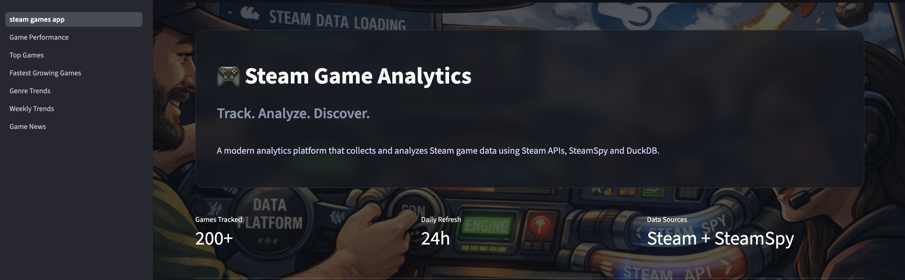
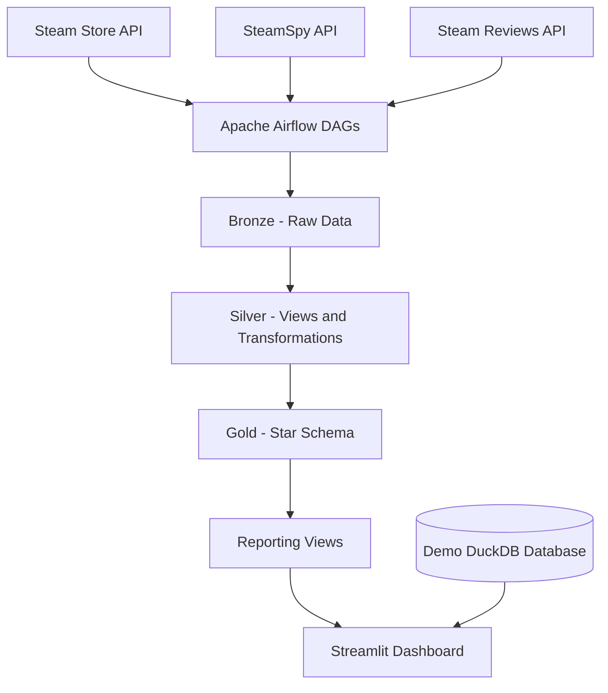
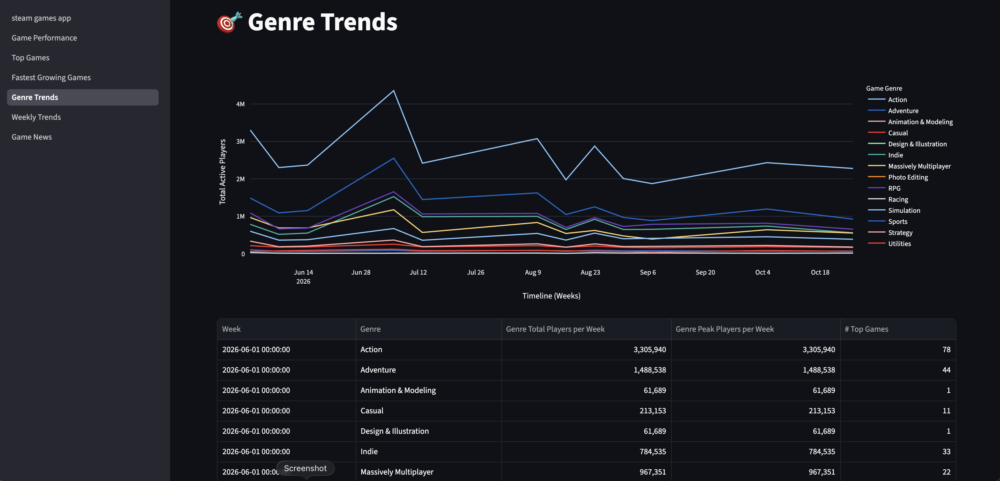
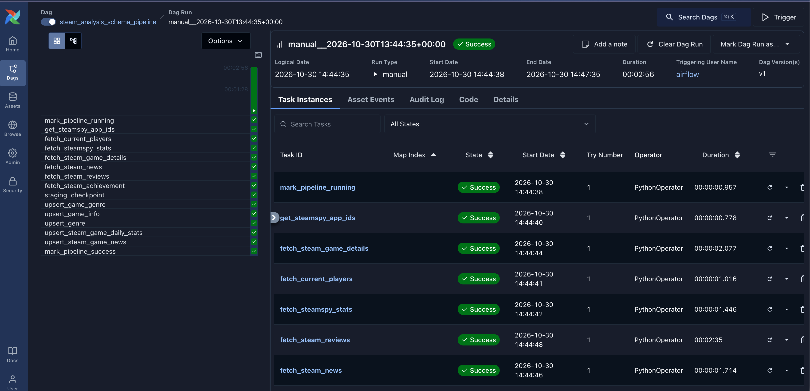

# 🎮 Steam Game Analytics Platform

A data engineering project that collects, processes, and visualizes Steam game data using Apache Airflow, DuckDB, and Streamlit.

The platform extracts data from multiple Steam-related APIs, transforms it using a **Bronze → Silver → Gold architecture**, stores analytical data in DuckDB, and exposes interactive dashboards through Streamlit.

The development of this project has been documented through a series of articles on [Datadweller on Substack](https://datadweller.substack.com/) and [Medium](https://medium.com/@gigilinux), covering the development process, technical decisions, and lessons learned.



## Features

- Integration with the Steam Store API
- SteamSpy API integration
- Steam Reviews API integration
- Workflow orchestration with Apache Airflow
- Bronze / Silver / Gold data architecture
- Raw data ingestion and staging
- SQL transformations and analytical views
- Gold layer organized around a star schema
- Reporting views for analytical queries
- Interactive dashboards built with Streamlit and Plotly
- DuckDB analytical database
- Dockerized application with Docker Compose
- Pre-populated demo database for exploring the dashboard without running the pipeline

## Architecture

The application follows an ELT-style workflow, separating data ingestion, transformation, analytical modeling, and visualization.



## Technologies

| Technology | Purpose |
|---|---|
| Python | Data ingestion and application logic |
| Apache Airflow | Workflow orchestration |
| DuckDB | Analytical database |
| SQL | Data transformations and data modeling |
| Streamlit | Interactive dashboard |
| Plotly | Data visualization |
| pandas | Data manipulation |
| aiohttp | Asynchronous HTTP requests |
| Docker and Docker Compose | Containerization and service orchestration |

## Repository Structure

```text
steam-game-analytics/
├── dags/                         # Airflow DAG definitions
├── scripts/                      # Shared Python modules and settings
├── sql/
│   ├── ddl/                      # Schema initialization
│   ├── dml/                      # Data transformations
│   └── staging/                  # Staging SQL
├── streamlit_app/                # Dashboard and pages
├── sample_data/                  # Demo database and documentation
├── docs/                         # Project documentation
│   └── images/
├── duckdb/                       # Local live database (not committed)
├── logs/                         # Local Airflow logs (not committed)
├── Dockerfile                    # Airflow image
├── Dockerfile.streamlit          # Streamlit image
├── docker-compose.yaml            # Application services
├── requirements-common.txt       # Shared dependencies
├── requirements-airflow.txt      # Airflow dependencies
├── requirements-streamlit.txt    # Dashboard dependencies
├── .env.example                  # Example environment configuration
├── .gitignore
└── README.md
```

## Prerequisites

Before running the application, install:

- [Docker Desktop](https://www.docker.com/products/docker-desktop/)
- [Git](https://git-scm.com/)

A local Python installation is not required because the application runs inside Docker containers.

## Installation

### 1. Clone the repository

Replace the URL with the actual URL of your GitHub repository.

```bash
git clone https://github.com/lmajellaro/steam-game-analytics.git
cd steam-game-analytics
```

### 2. Configure the environment

Create your local environment file:

```bash
cp .env.example .env
```

Review `.env` and adjust the values if necessary for your local Docker setup. Do not commit `.env` or any credentials.

### 3. Build and start the application

```bash
docker compose up -d --build
```

Check the status of the services:

```bash
docker compose ps
```

Once the services are ready, open:

- **Streamlit Dashboard:** [http://localhost:8501](http://localhost:8501)
- **Airflow Web Interface:** [http://localhost:8080](http://localhost:8080)

Use the Airflow credentials configured by your local deployment.
    
Default local development credentials:
- **Username:** `airflow`
- **Password:** `airflow`

## Demo Database

The repository includes a pre-populated DuckDB snapshot:

`sample_data/steam_games_sample.duckdb`

The dashboard uses this database by default, allowing you to explore the visualizations without waiting for data ingestion or configuring API access.

The demo database is a **static snapshot** and does not update automatically.

   

The demo database is read-only from the Streamlit container. To run your own ingestion pipeline, initialize and populate the live database first.

## Switching Between Demo and Live Data

The dashboard database is selected in `scripts/settings.py` through the `STREAMLIT_DB_PATH` variable.

### Demo mode (default)

The default configuration uses the sample database included in the repository:

```python
# Use the live database for local development:
# STREAMLIT_DB_PATH = "/app/data/steam_games.duckdb"

# Use the sample database for demo mode (e.g. for GitHub users):
STREAMLIT_DB_PATH = "/app/sample_data/steam_games_sample.duckdb"
```

In this mode, the dashboard reads the pre-populated demo snapshot. You can explore the application without initializing or populating a live database.

### Switch to live mode

To display data generated by your own Airflow pipeline, edit `scripts/settings.py`.

**1. Comment out the demo database line and uncomment the live database line.**

Change this:

```python
# Use the live database for local development:
# STREAMLIT_DB_PATH = "/app/data/steam_games.duckdb"

# Use the sample database for demo mode (e.g. for GitHub users):
STREAMLIT_DB_PATH = "/app/sample_data/steam_games_sample.duckdb"
```

To this:

```python
# Use the live database for local development:
STREAMLIT_DB_PATH = "/app/data/steam_games.duckdb"

# Use the sample database for demo mode (e.g. for GitHub users):
# STREAMLIT_DB_PATH = "/app/sample_data/steam_games_sample.duckdb"
```

**2. Make sure the live database has been initialized and populated.**

The live database is stored in the project's local `duckdb/` directory and is mounted into the Streamlit container at `/app/data/`. If you have not run the initialization and ingestion workflows yet, follow the Airflow instructions below.

**3. Restart Streamlit.**

After saving `scripts/settings.py`, run:

```bash
docker compose restart streamlit
```

Then reopen [http://localhost:8501](http://localhost:8501).

The dashboard will now read from the live database.

**Important:** changing `STREAMLIT_DB_PATH` only selects which database the dashboard reads. It does not initialize the database or trigger the ingestion pipeline.

The live database is excluded from version control.

## Airflow DAGs

The project provides three DAGs, available from the Airflow web interface at [http://localhost:8080](http://localhost:8080).

### 1. `duckdb_test`

[Open DAG in Airflow](http://localhost:8080/dags/duckdb_test)

**Execution:** Manual.

A sandbox DAG used to test write access to a test DuckDB database. It creates a test database, creates a test table, and writes a couple of records.

Use this DAG to verify that the environment can create and write to a DuckDB database.

### 2. `steam_analysis_schema_init`

[Open DAG in Airflow](http://localhost:8080/dags/steam_analysis_schema_init)

**Execution:** Manual.

Initializes a fresh instance of the project database and creates the associated database objects.

**Run this DAG only once when setting up a new project database.** Check the DAG's implementation and task behavior before rerunning it against a database that already contains data.

### 3. `steam_analysis_schema_pipeline`

[Open DAG in Airflow](http://localhost:8080/dags/steam_analysis_schema_pipeline)

**Execution:** Manual by default (schedule=None). To enable automatic execution, configure a schedule in the DAG definition.

**Important:** Ensure the initialization DAG `steam_analysis_schema_init` has been ran before starting utilizing this DAG.

Collects daily data from the configured sources and runs the pipeline's ingestion and transformation tasks.

You can also trigger the DAG manually when needed. Monitor its task status and logs in Airflow to check progress or troubleshoot failures.



## 🧹 Stopping the Environment

Stop the running services while retaining the containers and volumes:
```bash
docker compose stop
```

Stop and remove the containers:
```bash
docker compose down
```

Remove containers, network, and persistent volumes, including Airflow and PostgreSQL data. 
```bash  
docker compose down -v
```

## Data Sources

The project uses data from:

- [Steam Web API](https://steamcommunity.com/dev)
- [SteamSpy](https://steamspy.com/)

Data availability and coverage depend on the respective APIs and their endpoints.

This is an independent portfolio project and is not affiliated with or endorsed by Valve or SteamSpy.

## License

This project is licensed under the MIT License.
See the [LICENSE](LICENSE) file for details.
